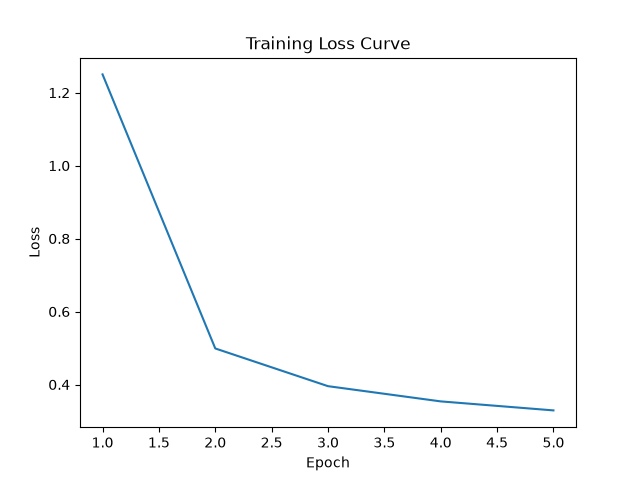

# MNIST Handwritten Digit Classification

A handwritten digit classification project implemented with PyTorch.

## 1. Project Overview

This project uses the MNIST dataset to train a simple fully connected neural network (MLP) for handwritten digit recognition.

The model classifies grayscale images of handwritten digits from 0 to 9.

## 2. Model Architecture

The model consists of:

- Flatten: converts a 28×28 image into a 784-dimensional vector.
- Fully Connected Layer 1: 784 → 128.
- ReLU: activation function.
- Fully Connected Layer 2: 128 → 10.

## 3. Dataset

- Dataset: MNIST
- Training samples: 60,000
- Test samples: 10,000
- Image size: 28×28
- Number of classes: 10

The dataset is automatically downloaded by torchvision.

## 4. Training

- Loss function: CrossEntropyLoss
- Optimizer: SGD
- Learning rate: 0.01
- Epochs: 5
- Batch size: 64

## 5. Results

Test Accuracy: **91.40%**

Training Loss Curve:



## 6. Project Structure

```text
mnist_classification/
├── train.py
├── predict.py
├── mnist_model.pth
├── loss.png
├── requirements.txt
├── README.md
└── .gitignore
```

The MNIST dataset is stored in the local `data/` directory and is excluded from Git.

## 7. How to Run

Install dependencies:

```bash
pip install -r requirements.txt
```

Train the model:

```bash
python train.py
```

Predict a handwritten digit:

```bash
python predict.py
```

## 8. Skills Learned

- PyTorch Dataset and DataLoader
- Building a neural network with `nn.Module`
- Forward propagation
- Loss calculation and backpropagation
- Model training and evaluation
- Model saving and loading
- Handwritten digit prediction